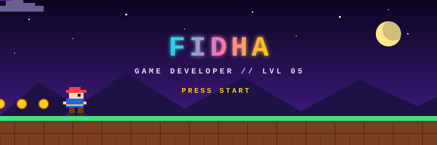
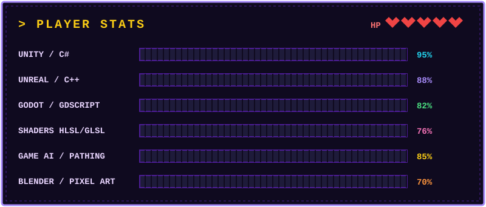

<div align="center">



<a href="https://github.com/USERNAME">
  
</a>

<br/>


</div>

## 🎮 Character Select

```yaml
class:      Gameplay Engineer
race:       Human (caffeinated)
guild:      Indie / Freelance
location:   Earth, mostly
side_quest: "Learning Rust & ray marching"
fun_fact:   "I've fixed more bugs than I've written. Probably."
```

<div align="center">



</div>

## 🧰 Inventory

<div align="center">


</div>


<div align="center">

<picture>
  <source media="(prefers-color-scheme: dark)" srcset="https://raw.githubusercontent.com/USERNAME/USERNAME/output/github-snake-dark.svg" />
  <source media="(prefers-color-scheme: light)" srcset="https://raw.githubusercontent.com/USERNAME/USERNAME/output/github-snake.svg" />
  
</picture>

</div>


<div align="center">


<sub>Open to freelance and cool ideas.</sub>

</div>
