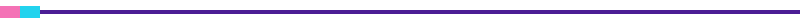

<div align="center">


<a href="https://github.com/USERNAME">
  
</a>

<br/>


[](https://YOURNAME.itch.io)
[](https://twitter.com/YOURNAME)
[](https://linkedin.com/in/YOURNAME)
[](mailto:you@example.com)



</div>

## 🎮 Character Select

```yaml
class:      Gameplay Engineer
race:       Human (caffeinated)
guild:      Indie / Freelance
location:   Earth, mostly
main_quest: "Ship [YOUR GAME TITLE]"
side_quest: "Learning Rust & ray marching"
ask_me_about: [game feel, procedural generation, shaders, tools]
fun_fact:   "I've fixed more bugs than I've written. Probably."
```

<div align="center">


</div>

## 🧰 Inventory

<div align="center">


</div>

## 🕹️ Quest Log (Featured Projects)

| 🎯 Quest | 📜 Description | 🛠️ Tech | ⭐ Status |
|---|---|---|---|
| **[Project Nebula](https://github.com/USERNAME/nebula)** | Roguelike space shooter with procedural levels | `Unity` `C#` | 🟡 In Progress |
| **[Pixel Tavern](https://github.com/USERNAME/pixel-tavern)** | Cozy tavern-management sim | `Godot` `GDScript` | 🟢 Released |
| **[ShaderLab](https://github.com/USERNAME/shaderlab)** | Collection of stylized shaders & VFX | `HLSL` `GLSL` | 🟢 Open Source |
| **[LevelForge](https://github.com/USERNAME/levelforge)** | Editor tool for rapid level prototyping | `Unreal` `C++` | 🔵 Prototype |

## 📊 Player Stats

<div align="center">


</div>

## 🐍 Contribution Snake

<div align="center">

<picture>
  <source media="(prefers-color-scheme: dark)" srcset="https://raw.githubusercontent.com/USERNAME/USERNAME/output/github-snake-dark.svg" />
  <source media="(prefers-color-scheme: light)" srcset="https://raw.githubusercontent.com/USERNAME/USERNAME/output/github-snake.svg" />
  
</picture>

</div>

## 🏆 Achievements

- 🥇 Shipped **N** games / jam entries
- 🎖️ Game Jam finalist: *[Jam name, year]*
- 🛠️ Built open-source tools used by **N+** devs
- 📚 Currently studying: *graphics programming, ECS architecture*

<div align="center">


<sub>🎲 Insert coin to collaborate. Open to jams, freelance and cool ideas.</sub>

</div>
